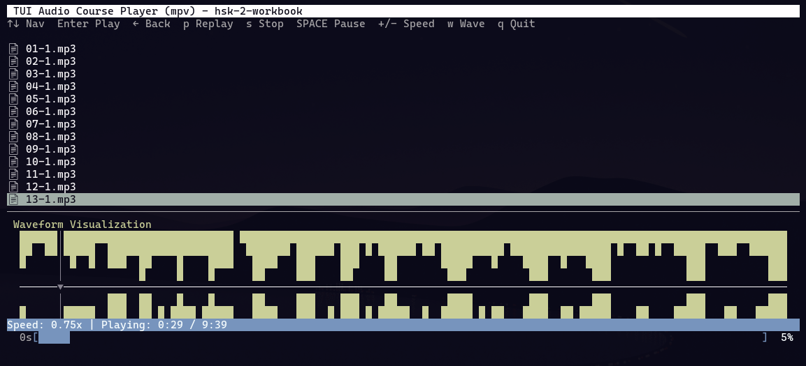

# 🎧 TUI Audio Course Player

**A terminal-based audio player for language learners, with waveform visualization and live speed control.**

Playback is handled by **mpv** (via its JSON IPC interface). Speed changes apply live, without restarting the file, and preserve the original pitch.

---

## 📸 Screenshot


---

## ✨ Key Features

| Feature | Description |
|---------|-------------|
| 📁 **File Explorer** | Navigate course directories with the keyboard |
| ▶️ **Audio Playback** | MP3, WAV, OGG, FLAC, M4A via mpv |
| ⚡ **Live Speed Control** | 0.5x–2.0x, applied instantly, pitch preserved |
| ⏸ **Real Pause/Stop** | Playback state is controlled by mpv, not simulated |
| 📊 **Waveform Visualization** | Optional; needs numpy (+ pydub for non-WAV files) |
| ⏱ **Progress Bar** | Position read from the player, not estimated |
| 📄 **Document Support** | Opens PDFs in your default viewer |

---

## 🚀 Quick Start

### 1. Clone and install mpv

The only hard requirement is the mpv binary:

```bash
git clone https://github.com/toctocduck/TUI-Audio-Course-Player.git
cd TUI-Audio-Course-Player

# Debian/Ubuntu
sudo apt install mpv

# Fedora
sudo dnf install mpv

# Arch Linux
sudo pacman -S mpv

# macOS (with Homebrew)
brew install mpv
```

No Python audio libraries are needed for playback. A standard `python3` (3.8+) is enough; curses is in the standard library on Linux.

### 2. Optional: waveform visualization

The waveform needs numpy, and pydub for compressed formats (MP3, OGG, M4A...). Since Debian/Ubuntu block `pip` system-wide (PEP 668), use a venv — any path works, this is just an example:

```bash
python3 -m venv ~/tui-player-venv
~/tui-player-venv/bin/pip install numpy pydub
```

Note: on Python 3.13+, pydub also needs `audioop-lts`:

```bash
~/tui-player-venv/bin/pip install audioop-lts
```

WAV files work with numpy alone. Without any of these, the player still works and shows the duration (via ffprobe), just no waveform bars.

### 3. Run

```bash
# basic: playback only
python3 tui_audio_course_player.py

# with the waveform venv
~/tui-player-venv/bin/python tui_audio_course_player.py

# debug log next to the script (tui_player_debug.log)
python3 tui_audio_course_player.py --debug
```

Or with the launcher script:

```bash
./run_player.sh [--debug]
```

The launcher uses the venv interpreter if available, otherwise falls back to the system `python3`.

---

## 🎹 Keyboard Shortcuts

| Key | Action |
|-----|--------|
| `↑` / `↓` | Move cursor |
| `→` / `Enter` | Enter directory or play file |
| `←` / `ESC` | Go back to parent directory (ESC at start quits) |
| `h` | Back to starting directory |
| `q` | Quit |
| `p` | Replay selected audio file |
| `SPACE` | Pause / resume |
| `s` | Stop |
| `+` / `=` | Speed up |
| `-` / `_` | Slow down |
| `w` | Toggle waveform |

Speed presets: **0.5x, 0.75x, 1.0x, 1.25x, 1.5x, 2.0x**. Changes take effect immediately on the running file.

---

## 💡 Use Cases

Designed for language learning (e.g. HSK audio courses):

- **Accents and intonation**: speed changes keep the original pitch, so slowed-down speech stays natural
- **Shadowing practice**: 0.75x or 0.5x without chipmunk effect
- **Listening comprehension**: adjust speed on the fly without restarting the lesson
- **Long lessons**: real pause, stop and position tracking

Suggested layout for course materials:

```
MyCourses/
├── Chinese/
│   ├── HSK-1/
│   │   ├── audios/lesson-01.mp3
│   │   └── workbook.pdf
│   └── HSK-2/
└── English/
```

---

## ⚙️ Configuration

Supported types are defined at the top of the script:

```python
AUDIO_EXTS = {'.mp3', '.wav', '.ogg', '.flac', '.m4a'}
DOC_EXTS = {'.pdf'}
```

---

## 🐛 Troubleshooting

### No audio / player refuses to play

Check that mpv is installed: `mpv --version`. The TUI shows a warning line at startup if mpv is missing. Run `mpv file.mp3` manually to verify your audio output works.

### Speed change does nothing

With the mpv backend, speed always works. If it doesn't, check the debug log (`--debug`) — the `set_property speed` IPC commands and any errors are logged there.

### Waveform not showing

WAV: install numpy. MP3/OGG/M4A: install numpy + pydub (+ `audioop-lts` on Python 3.13+). This is optional and does not affect playback.

### Debug log

Run with `--debug` or set `TUI_DEBUG=1`. The log (`tui_player_debug.log`, written next to the script) records: detected dependencies, spawned mpv commands, every IPC command, playback positions, and full tracebacks of any error.

---

## 🔒 Privacy & Security

- Does **not** collect or send any data
- Runs **completely offline**
- No keys, secrets, or telemetry in the source

---

## 🤖 AI Assistance

Developed with the help of AI tools (Mistral Vibe). The playback backend was rewritten around mpv after diagnosing, via the built-in debug log, that the previous pygame/pydub backend could not provide live speed control or reliable pause/stop.

This is a personal project. I'm not a professional software developer.

---

## 📜 License

MIT License — see [LICENSE](LICENSE).

---

## 🙏 Acknowledgments

- **[mpv](https://mpv.io/)** — audio playback and speed control
- **[curses](https://docs.python.org/3/library/curses.html)** — terminal UI
- **[numpy](https://numpy.org/)** — waveform processing
- **[pydub](https://github.com/jiaaro/pydub)** — optional waveform decoding
